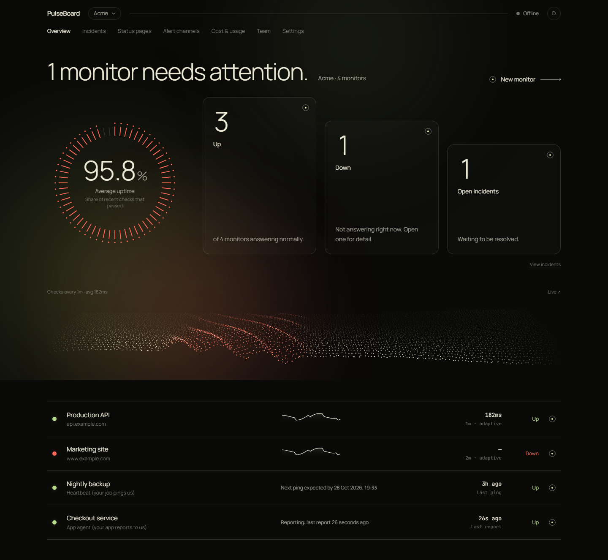
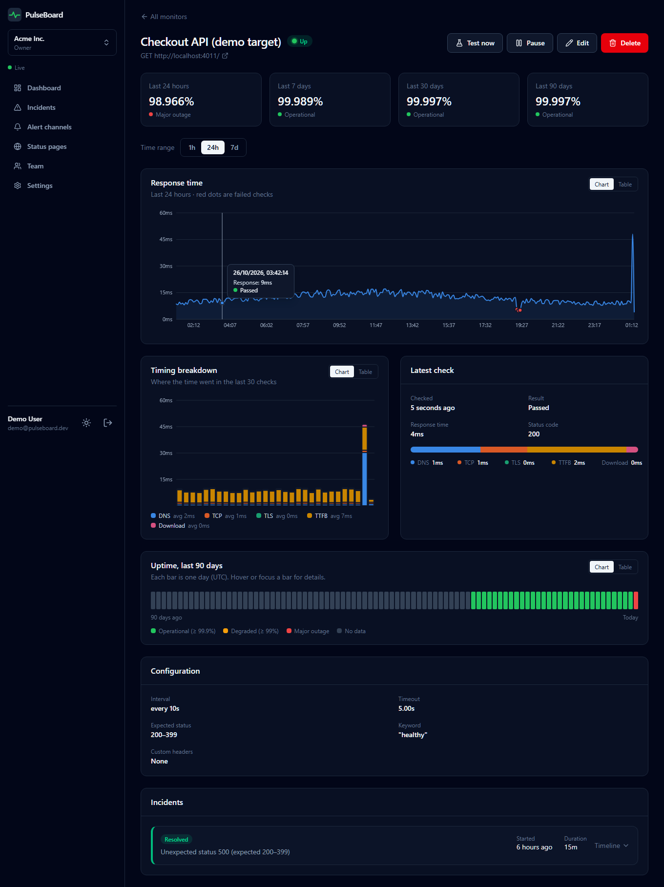
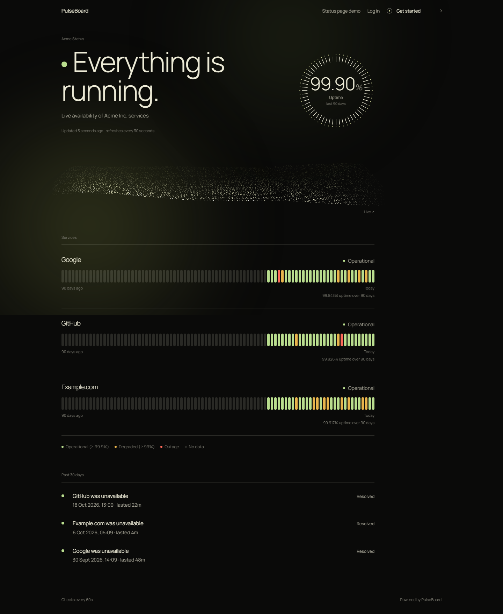
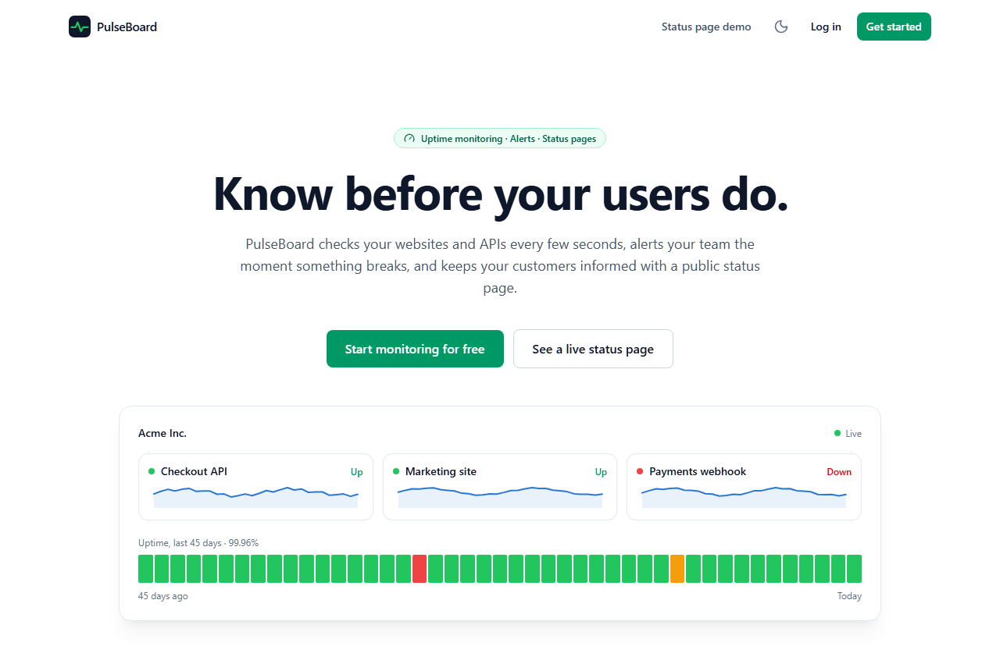
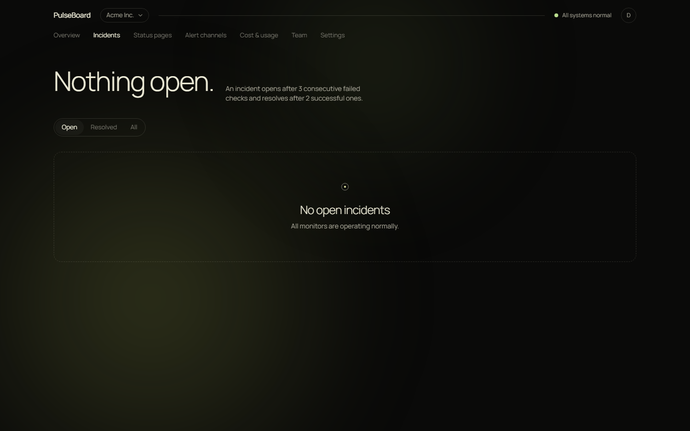
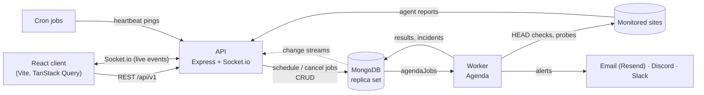

# PulseBoard

**Cost-aware uptime monitoring and public status pages, built on the MERN stack.**
PulseBoard watches your websites, APIs and background jobs, opens an incident when one goes
down, alerts your team by Email (Resend), Discord or Slack, shows everything live on a dashboard,
and publishes a public status page for your users.

It is **push-first**: polling a site costs its owner real requests (and often database or
paid-API calls), so PulseBoard prefers to be told. Cron jobs ping a heartbeat URL, Express apps
report through a tiny agent, and PulseBoard only sends requests when something goes quiet. When
it does poll, it uses cheap `HEAD` requests, slows down while everything is healthy, shows what
each monitor costs and respects a monthly budget.

MongoDB is the only infrastructure: it stores the data, it is the job queue (Agenda), and its
change streams are the realtime event bus. No Redis, no message broker.

**Live demo:** https://pulseboard-ten-alpha.vercel.app (frontend on Vercel, API + worker on a free
Render service, data on MongoDB Atlas). Use the demo login button on the sign-in page. The free
backend sleeps when idle, so the first request after a pause can take up to a minute.



## Monitor types

| Type                              | How it works                                                                                                                                                          | Requests to your servers                                     |
| --------------------------------- | --------------------------------------------------------------------------------------------------------------------------------------------------------------------- | ------------------------------------------------------------ |
| **Website / API** (`http`, pull)  | PulseBoard checks a URL on an interval: `HEAD` by default, adaptive interval, optional keyword.                                                                       | one per check (43,200 a month at 1 min, fewer when adaptive) |
| **Heartbeat** (`heartbeat`, push) | Your cron job or worker calls a secret URL when it runs (`/start`, `/fail` optional). No ping within the expected period + grace → incident.                          | **0**                                                        |
| **Agent** (`agent`, push)         | `pulseboard-agent` in your Express app reports request rate, error rate and p50/p95/p99 latency. Silent agent → PulseBoard probes your URL before deciding it's down. | **0** while reporting, 3 probes per silence                  |

All three share the same incident engine, uptime maths, 90-day bars, alerts and status pages.

### Install the agent

```bash
npm install pulseboard-agent
```

```js
import express from 'express';
import { pulseboard } from 'pulseboard-agent';

const app = express();
app.use(
  pulseboard({ apiKey: process.env.PULSEBOARD_KEY, endpoint: 'https://<your-pulseboard>/api/v1' }),
);
```

Create an **Agent** monitor in the dashboard to get the key (it is shown once). The agent has no
dependencies, never blocks or throws into your app, keeps bounded memory and sends only
aggregates and route **patterns** (`/api/orders/:id`): no URLs, ids, query strings, headers or
bodies. Details in [packages/agent/README.md](packages/agent/README.md).

### Heartbeat in one line

```bash
# crontab: run the backup, then tell PulseBoard it worked
0 3 * * * /usr/local/bin/backup.sh && curl -fsS https://<your-pulseboard>/api/v1/ping/<token>
```

## Cost features

- **Cheap checks**: new http monitors use `HEAD` (falling back to `GET` once if the server
  rejects it, and remembering that), never download a body unless a keyword needs it, and
  identify themselves (`User-Agent: PulseBoard/1.0 (+…/bot)`, `X-PulseBoard-Check: 1`) so you
  can filter them out of analytics and billing. The public `/bot` page explains how.
- **Cost visibility**: every request sent is counted per monitor and month. Set a price per
  1,000 requests (INR, USD, EUR or GBP) and the form shows a live monthly estimate; the monitor
  page shows requests and cost so far.
- **Adaptive intervals**: after 10 good checks in a row the interval doubles (up to the
  "slowest" you set); a failure, an outage or an unusually slow response brings it straight back.
- **Budgets**: a monthly request budget per monitor. 80 % → one warning alert; 100 % → slow down to
  every 15 minutes or pause until the 1st, plus one alert. Raising the budget lifts it at once.
- **Cost & usage page**: requests sent, requests saved compared with 1-minute polling, estimated
  monthly requests and cost per currency for the whole workspace, with a sortable per-monitor
  table and budget bars.

## Features

- **HTTP checks every 10–30 s** (GET/HEAD/POST) with expected status range, keyword match,
  custom headers, timeout, up to 3 redirects, and a **DNS / TCP / TLS / TTFB / download**
  timing breakdown measured on a fresh connection every time. TLS certificate expiry badge.
- **Incidents without noise**: down after 3 consecutive failures, up after 2 successes (a
  heartbeat: the first missed period, the first ping). Race-safe (concurrent checks can't open
  two incidents) and timed from the first failed check.
- **Agent dashboards**: live request rate, error rate (with your threshold), latency
  percentiles and top routes for apps running the agent. A silent agent whose app still answers
  is shown as **degraded** (with one notice), not as an outage.
- **Alerts** to Email (Resend, HTML), Discord (embeds) and Slack (Block Kit), sent as background jobs
  with retries after 30 s, 2 min and 8 min, and a full incident timeline.
- **Import from GitHub** (for people who signed in with GitHub): finds the sites behind your public
  repos (homepage, GitHub Pages, deployments, README links), checks which are live, and creates the
  monitors you pick in one step. Deterministic, no AI; see [Import from GitHub](#import-from-github).
- **Live dashboard**: MongoDB change streams → Socket.io push status, response times and
  incidents to the browser instantly (falls back to polling if the socket drops).
- **Analytics**: uptime for 24 h / 7 / 30 / 90 days, response-time chart (1 h / 24 h / 7 d,
  downsampled server-side), timing breakdown, 90-day uptime bars. Every chart has a table view.
- **Health deck** on every monitor: live metric cards (uptime, p95, failed checks, request rate,
  lateness... by monitor type) with sparklines, a detail panel and a keyboard-navigable selection,
  fed by `GET /monitors/:mid/metrics` and updated from live check events.
- **Signal field**: a generative particle wave on the dashboard and status pages that reacts to
  real response times, check frequency, live checks and incidents (WebGL with a 2D fallback).
- **Sign in with Google or GitHub** (optional, enabled by credentials), besides email and password.
- **Public status pages**: no login, overall banner, per-service 90-day bars, incident
  history; whitelist-only data, cached for 30 s.
- **Teams**: workspaces with owner / member / viewer roles, enforced on every request.
- **"Test now"**: run a one-off check from the monitor form before saving.
- **Security**: JWT access tokens in memory + rotating httpOnly refresh cookie with reuse
  detection, bcrypt, SSRF protection (at save time _and_ connect time), helmet, strict CORS,
  rate limits, input validation with Zod everywhere.
- Dark-only "Ambient Signal" UI (near-black, soft moss light, hairlines), responsive down to phone
  width, with reduced-motion support.

| Monitor detail                                  | Public status page                                      |
| ----------------------------------------------- | ------------------------------------------------------- |
|  |  |

| Landing page                                  | Incident timeline                            |
| --------------------------------------------- | -------------------------------------------- |
|  |  |

## Architecture



- **API** (`apps/api`): REST, auth, RBAC, analytics, Socket.io, and the public ping and agent
  report endpoints. Creates Agenda jobs but never runs them, unless `RUN_MODE=combined`, which
  also starts the worker inside the same process (one-service deployments, see [Deploy](#deploy)).
- **Worker** (`apps/worker`): runs `run-check`, `send-alert`, `send-notice`,
  `heartbeat-overdue`, `agent-silence`, `rollup`, `finalize-rollup` and `budget-reset` jobs;
  serves only `/health`. Several workers can run at once; Agenda's locking means a check never
  runs twice. The same runner can live inside the API (`RUN_MODE=combined`); the standalone
  worker app keeps working as before.
- **Shared** (`packages/shared`): Mongoose models, Zod schemas (also used by client forms),
  check runner, SSRF guard, incident engine and state machine, uptime and cost maths.
- **Agent** (`packages/agent`): `pulseboard-agent`, the npm package for customers' Express apps.
- **Demo target** (`apps/demo-target`): a tiny site you can switch to up / down / slow / 500 /
  missing-keyword, running the agent, with a heartbeat script, for live demos.

More diagrams (check lifecycle, incident states, data model) in
[docs/ARCHITECTURE.md](docs/ARCHITECTURE.md). Every design decision and its alternatives are
logged in [docs/DECISIONS.md](docs/DECISIONS.md). The full API is in [docs/API.md](docs/API.md).

## Tech stack

React 18, Vite, React Router, Tailwind CSS v4, TanStack Query, Recharts, Socket.io client,
React Hook Form + Zod · Node 20+, Express 5, Mongoose 9, Zod, JWT, bcrypt, helmet, pino,
Socket.io · MongoDB (time-series collection for checks, change streams) · Agenda v6 (MongoDB
backend) · Resend (email alerts; Nodemailer for the SMTP fallback and the local test inbox) ·
Vitest, Supertest, mongodb-memory-server.

## Run it locally

Requirements: **Node 20+** and a MongoDB **replica set** (needed for change streams): a free
[MongoDB Atlas](https://www.mongodb.com/atlas) cluster, or `docker compose up -d` if you have
Docker Desktop. Docker is optional.

```bash
git clone <repo-url> pulseboard && cd pulseboard
cp .env.example .env         # works as-is for local development
docker compose up -d         # local MongoDB replica set (rs0); skip it if MONGODB_URI in .env is an Atlas string
npm install
npm run migrate              # only when upgrading an existing database (safe to re-run)
npm run seed                 # demo account with sample data (safe to re-run; `npm run seed:clear` removes it)
npm run dev                  # api :4000 · worker :4002/health · client :5173 · demo-target :4011
npm run heartbeat -w @pulseboard/demo-target   # optional, in a second terminal: the demo cron job
```

The seed writes `apps/demo-target/.pulseboard-demo.json` (git-ignored) with the demo agent key
and heartbeat URL, so the demo-target starts reporting through the agent by itself.

Open <http://localhost:5173> and log in with **demo@pulseboard.dev / demo1234** (the login
page has a "Fill in" button in demo mode). The public status page is at
<http://localhost:5173/status/acme>, and the demo target's control panel at
<http://localhost:4011/admin>.

### Sample data and `npm run seed:clear`

The seed creates a workspace with seven monitors, and only some of them have history:

- **Fictional, with sample data:** **Demo API**, **Demo Checkout**, **Demo Cron Job** and
  **Demo Agent**. They watch the local demo-target (or receive its heartbeat and agent reports), so
  their 30 days of uptime, 24 hours of checks, past incidents, usage and agent reports are
  invented. Every document they own has `isSeed: true`, and the app marks it with a
  **Sample data** badge (incident cards, charts, gauges and the public status page).
- **Real, starting empty:** **Google**, **GitHub** and **Example.com**. They are real monitors with
  no invented history, so they show "No data yet" until the worker's first check, and every number
  afterwards is real. They keep their cost and budget settings for the cost demo.

```bash
npm run seed:clear           # deletes every isSeed document: the fictional monitors and all their data
```

`seed:clear` needs no confirmation flag: it prints what it is about to delete, deletes it, and
prints the counts. It removes the fictional monitors together with their checks, incidents,
rollups, usage, agent reports and scheduler jobs, and takes them off status pages. Real monitors and
their data, users, workspaces and alert channels are never touched, and a second run does nothing. It
refuses to run without `MONGODB_URI`. Deleting time-series check results with a filter needs
MongoDB 7.0 or newer (Atlas and the docker-compose image qualify).

The fictional monitors only make sense beside a local demo-target, so on a hosted database they
are skipped (the real sites are still created). Set `SEED_LOCAL_DEMO=true` to include them anyway,
or `false` to leave them out locally.

**Databases seeded by an older version** gave Google, GitHub and the others backfilled history
too. After upgrading, `npm run migrate` runs migration `004-mark-legacy-sample-data`: history
cannot predate its monitor, so incidents that started before a monitor was created and daily
rollups for days entirely before it existed are flagged `isSeed`, and raw checks older than the
monitor are deleted. Anything created at or after the monitor's creation is kept. Then
`npm run seed:clear` removes the flagged history.

To receive real Discord or Slack alerts, put a webhook URL in `SEED_DISCORD_WEBHOOK_URL` or
`SEED_SLACK_WEBHOOK_URL` before seeding, or add a channel on the **Alert channels** page.
Email alerts are sent through Resend. Without `RESEND_API_KEY` (the usual local setup) they go to a
free Ethereal test inbox instead, and each message's preview link appears in the incident timeline.

### Sign in with Google / GitHub (optional)

The buttons appear only for providers whose client id **and** secret are set in `.env`
(restart the API after adding them). The callback URL is `<APP_URL>/api/v1/auth/oauth/<provider>/callback`
(`APP_URL` falls back to `DASHBOARD_URL`); it goes through the client origin, which proxies
`/api` to the API.

| Environment | Google callback                                               | GitHub callback                                               |
| ----------- | ------------------------------------------------------------- | ------------------------------------------------------------- |
| Development | `http://localhost:5173/api/v1/auth/oauth/google/callback`     | `http://localhost:5173/api/v1/auth/oauth/github/callback`     |
| Production  | `https://<your-vercel-app>/api/v1/auth/oauth/google/callback` | `https://<your-vercel-app>/api/v1/auth/oauth/github/callback` |

- **Google**: [Google Cloud Console → APIs & Services → Credentials](https://console.cloud.google.com/apis/credentials)
  → Create credentials → OAuth client ID → _Web application_. Add both callback URLs under
  _Authorized redirect URIs_ (configure the OAuth consent screen first if asked; scopes
  `openid email profile`). Copy the id and secret into `GOOGLE_CLIENT_ID` / `GOOGLE_CLIENT_SECRET`.
- **GitHub**: [Settings → Developer settings → OAuth Apps](https://github.com/settings/developers)
  → New OAuth App. Homepage: your app URL; _Authorization callback URL_: the callback above.
  GitHub allows one callback per app, so create one app for development and one for production.
  Generate a client secret and copy both into `GITHUB_CLIENT_ID` / `GITHUB_CLIENT_SECRET`.

A provider account is linked to an existing user only when the provider reports the email as
verified; otherwise a new user (no password) with a personal workspace is created. Run
`npm run migrate` once on an existing database to add the identities index.

### Import from GitHub

Signed in with GitHub? The dashboard shows **Import from GitHub** next to "New monitor" (members and
owners). It lists your **public** repositories (archived ones skipped, forks only if you turn them on),
and for each one collects candidate site URLs from the repo's homepage, its GitHub Pages site, its
latest deployments and links in its README (hosting domains such as vercel.app, netlify.app,
onrender.com, or links labelled demo, live or website). Badges, images, github.com and localhost are
left out, duplicates are merged, and each URL is checked with the normal SSRF-guarded check runner
(HEAD, 5 s) so you can see **Live**, **Redirect** or **Down** before choosing. You tick what you want
and PulseBoard creates the monitors (named after the repo, HEAD, every 5 minutes, adaptive on),
optionally adding them to a new or existing status page.

- It uses GitHub's API, not scraping, and asks for no extra permission: sign-in already requests only
  `read:user` and `user:email`, so private repositories are out of reach.
- The GitHub token is kept **encrypted** (AES-256-GCM) and only used for this import. People who
  signed in before this feature exist are asked to sign in with GitHub once more.
- Results are cached for 10 minutes, and GitHub's rate limits are respected. Details and limits:
  [DECISIONS.md](docs/DECISIONS.md) (D106) and [docs/API.md](docs/API.md).

### Scripts

| Command                                        | What it does                                                                                                   |
| ---------------------------------------------- | -------------------------------------------------------------------------------------------------------------- |
| `npm run dev`                                  | Runs API, worker, client and demo-target with live reload                                                      |
| `npm run seed`                                 | (Re)creates the demo account with sample data                                                                  |
| `npm run seed:clear`                           | Deletes all sample data (`isSeed`), keeps real monitors and data                                               |
| `npm run migrate`                              | Applies pending schema migrations (idempotent)                                                                 |
| `npm run seed:demo-incidents`                  | Adds one fictional monitor with incident history to the demo account (for recordings; `seed:clear` removes it) |
| `npm run rollups:rebuild`                      | One-off: recalculates every daily rollup with the current uptime formula                                       |
| `npm run heartbeat -w @pulseboard/demo-target` | Demo cron job: pings the heartbeat (`--fail`, `--stop-after <n>`)                                              |
| `npm test`                                     | All test suites (shared, API, worker, client, demo-target, agent)                                              |
| `npm run test:coverage -w @pulseboard/shared`  | Coverage of the shared core logic                                                                              |
| `npm run lint`                                 | ESLint across the monorepo                                                                                     |
| `npm run format`                               | Prettier across the monorepo                                                                                   |

## Environment variables

All variables live in one `.env` at the repository root (see `.env.example`).

| Variable                       | Used by                | Default / example                                                           | Purpose                                                                                                                                       |
| ------------------------------ | ---------------------- | --------------------------------------------------------------------------- | --------------------------------------------------------------------------------------------------------------------------------------------- |
| `NODE_ENV`                     | all                    | `development`                                                               | `production` enables secure cookies and JSON logs                                                                                             |
| `MONGODB_URI`                  | api, worker            | `mongodb://localhost:27017/pulseboard?replicaSet=rs0&directConnection=true` | Must be a replica set (change streams)                                                                                                        |
| `LOG_LEVEL`                    | api, worker            | `info`                                                                      | pino log level                                                                                                                                |
| `DEMO_MODE`                    | api, worker            | `true`                                                                      | Allows 10 s check intervals (30 s otherwise); shows demo login                                                                                |
| `ALLOW_PRIVATE_TARGETS`        | api, worker            | `true` locally, `false` in production                                       | Allows monitoring localhost/private IPs (local demo-target)                                                                                   |
| `RUN_MODE`                     | api                    | `api` (or `combined`)                                                       | `combined` makes the API also run the worker in the same process (one-service hosting). `/health` then reports `worker`                       |
| `API_PORT` (or `PORT`)         | api                    | `4000`                                                                      | HTTP port                                                                                                                                     |
| `CLIENT_ORIGIN`                | api                    | `http://localhost:5173`                                                     | CORS + Socket.io allowed origin                                                                                                               |
| `JWT_ACCESS_SECRET`            | api                    | 32+ random chars                                                            | Signs access tokens                                                                                                                           |
| `JWT_REFRESH_SECRET`           | api                    | 32+ random chars, different                                                 | Signs refresh tokens                                                                                                                          |
| `ACCESS_TOKEN_TTL`             | api                    | `15m`                                                                       | Access token lifetime                                                                                                                         |
| `REFRESH_TOKEN_TTL_DAYS`       | api                    | `7`                                                                         | Refresh token lifetime                                                                                                                        |
| `BCRYPT_COST`                  | api                    | `12`                                                                        | Password hashing work factor                                                                                                                  |
| `AUTH_RATE_LIMIT_MAX`          | api                    | `20`                                                                        | Login/register attempts per IP per 15 min                                                                                                     |
| `TRUST_PROXY`                  | api                    | `false` (`true` on Render)                                                  | Real client IPs behind a proxy                                                                                                                |
| `GOOGLE_CLIENT_ID` / `_SECRET` | api                    | empty                                                                       | Enables "Sign in with Google" (both needed)                                                                                                   |
| `GITHUB_CLIENT_ID` / `_SECRET` | api                    | empty                                                                       | Enables "Sign in with GitHub" (both needed)                                                                                                   |
| `GITHUB_TOKEN_ENCRYPTION_KEY`  | api                    | empty → derived from `JWT_REFRESH_SECRET`                                   | Optional, 32+ characters. Encrypts the stored GitHub token (AES-256-GCM); changing it makes users sign in with GitHub again                   |
| `WORKER_HEALTH_PORT`           | worker                 | `4002`                                                                      | Worker `/health` port                                                                                                                         |
| `AGENDA_MAX_CONCURRENCY`       | worker, api (combined) | `20`                                                                        | Checks a worker runs in parallel                                                                                                              |
| `DASHBOARD_URL`                | api, worker            | `http://localhost:5173`                                                     | Links in alerts                                                                                                                               |
| `APP_URL`                      | api, worker            | empty → `DASHBOARD_URL`                                                     | Public web app URL: checker User-Agent, OAuth callback URLs                                                                                   |
| `RESEND_API_KEY`               | api, worker            | empty                                                                       | Email alerts through Resend (free tier, one HTTPS call). Empty = Ethereal test inbox, for local development                                   |
| `ALERT_FROM_EMAIL`             | api, worker            | `PulseBoard <alerts@pulseboard.local>`                                      | Sender of alert emails. Resend needs an address on a verified domain; until then `onboarding@resend.dev` is used                              |
| `SMTP_HOST` … `SMTP_PASS`      | api, worker            | empty                                                                       | Optional fallback, used only when `RESEND_API_KEY` is empty                                                                                   |
| `DEMO_READ_ONLY`               | api, worker            | `false`                                                                     | Public demo: the demo user is a read-only Viewer, a banner says so, and the worker resets the demo data daily                                 |
| `DEMO_OWNER_EMAIL`             | api, worker, seed      | empty                                                                       | Account that owns the demo workspace when `DEMO_READ_ONLY=true`; empty = a login-less owner account                                           |
| `SEED_DISCORD_WEBHOOK_URL`     | seed                   | empty                                                                       | Creates a Discord channel when seeding                                                                                                        |
| `SEED_SLACK_WEBHOOK_URL`       | seed                   | empty                                                                       | Creates a Slack channel when seeding                                                                                                          |
| `SEED_ALERT_EMAIL`             | seed                   | empty                                                                       | Email channel target (default: the demo user)                                                                                                 |
| `SEED_DEMO_TARGET_URL`         | seed                   | empty → `http://localhost:4011/`                                            | Demo-target URL to monitor (set to the deployed one in prod)                                                                                  |
| `SEED_LOCAL_DEMO`              | seed                   | auto: on for a local database                                               | `true`/`false` forces the fictional Demo API, Checkout, Cron Job and Agent monitors on or off. Off on a hosted database (they would sit down) |
| `SEED_API_URL`                 | seed                   | empty → `http://localhost:4000/api/v1`                                      | API URL written to the demo file for the agent and heartbeat                                                                                  |
| `DEMO_TARGET_PORT`             | demo-target            | `4011`                                                                      | Port (4001 is often taken by VS Code)                                                                                                         |
| `PULSEBOARD_AGENT_KEY`         | demo-target            | empty → seed file                                                           | Agent key for the demo-target's own agent                                                                                                     |
| `PULSEBOARD_ENDPOINT`          | demo-target            | empty → seed file                                                           | PulseBoard API base URL for the agent (`…/api/v1`)                                                                                            |
| `HEARTBEAT_URL`                | heartbeat              | empty → seed file                                                           | Ping URL used by the demo heartbeat script                                                                                                    |
| `VITE_API_URL`                 | client                 | `/api/v1`                                                                   | API base path (proxied/rewritten to the API)                                                                                                  |
| `VITE_SOCKET_URL`              | client                 | `http://localhost:4000`                                                     | Socket.io server (the API's public URL in production)                                                                                         |

## Testing

```bash
npm test
```

794 tests across six workspaces, all run against an in-memory MongoDB **replica set**
(so change streams and transactions behave like production):

- **Unit**: incident state machine (incl. flapping and per-type thresholds), uptime maths, SSRF
  IP checker, check evaluation, schemas, alert formatting, cost estimator, adaptive interval
  rules, budget states, agent report evaluation; the agent SDK's aggregation, percentiles,
  route patterns, bounded memory and failure handling.
- **Upgrade**: HEAD→GET fallback and usage metering; adaptive intervals applied to **real**
  Agenda jobs; budget warning/slow/pause exactly once and the monthly reset; heartbeat pings,
  overdue detection with two concurrent detectors; agent reports, silence → probes → incident
  or degraded; migrations idempotent; workspace usage; one test file proving http, heartbeat
  and agent monitors get identical uptime, rollups, status pages, incidents and alerts.
- **Integration**: auth flow incl. refresh rotation and reuse detection; RBAC matrix; monitor
  CRUD + real Agenda jobs created/cancelled; check runner against a local HTTP server
  (timeouts, redirects, body cap); incident engine incl. a concurrency race; alert retries;
  rollups; analytics endpoints; status pages (public endpoint leaks nothing private).
- **Change streams**: monitor updates emit `check:result`, incident inserts emit
  `incident:opened`, and events missed during a restart are delivered via resume tokens.
- Shared core logic coverage: **≥ 90 % statements** (`npm run test:coverage -w @pulseboard/shared`).

## Deploy

**MongoDB Atlas**: create a cluster (the free M0 tier works; Atlas clusters are replica sets,
so change streams work), a database user, and allow access from Render. Copy the `mongodb+srv://`
connection string.

**Render (one free web service)**: New → Blueprint → select this repository. Render reads
[`render.yaml`](render.yaml) and creates a single web service, `pulseboard-api`, on the free plan.
It sets `RUN_MODE=combined`, so the API process also runs the worker (checks, heartbeats,
alerts, rollups); there is no separate worker service. Then fill in the variables marked
`sync: false`:

- `MONGODB_URI`: the Atlas string.
- `CLIENT_ORIGIN` and `DASHBOARD_URL`: your Vercel URL, e.g. `https://pulseboard.vercel.app`.
- `RESEND_API_KEY` and `ALERT_FROM_EMAIL` (email alerts through Resend, see below).
- `DEMO_READ_ONLY=true` for a public demo (already set by `render.yaml`).
- OAuth credentials (optional): `GOOGLE_CLIENT_*` / `GITHUB_CLIENT_*`, see
  [Sign in with Google / GitHub](#sign-in-with-google--github-optional).

JWT secrets are generated by Render.

> **Email (Resend):** email alerts are sent through [Resend](https://resend.com), which has a free
> tier and a one-call HTTPS API, so it also works on Render's free plan (which blocks outbound SMTP).
> Until you verify a domain at resend.com, mail can only be sent to your own Resend account address.
> Discord and Slack alerts are unaffected.
>
> **Free plan caveat:** a free Render web service spins down after about 15 minutes without
> HTTP traffic, and **no checks run while it is asleep**. Keep it awake by requesting
> `https://<your-api>.onrender.com/health` every 10 minutes from an external scheduler
> (cron-job.org, UptimeRobot...), or change `plan: free` to `plan: starter`. On wake-up the
> service reconciles its jobs and carries on. It also has 512 MB of memory, so
> `AGENDA_MAX_CONCURRENCY` is set to 5 there. To split the worker out again later, set
> `RUN_MODE=api` (or remove it) and add a background worker running `npm start -w @pulseboard/worker`.

**Vercel (client)**: import the repository, set **Root Directory** to `apps/client`
(framework: Vite). In [`apps/client/vercel.json`](apps/client/vercel.json) replace
`pulseboard-api.onrender.com` with your API's Render hostname; Vercel then proxies `/api/*` to
Render, so the refresh cookie stays first-party. Set the environment variable
`VITE_SOCKET_URL=https://<your-api>.onrender.com` (Socket.io connects to the API directly).

**Seed production** (optional): run once from your machine with production values:

```bash
MONGODB_URI="<atlas uri>" SEED_DISCORD_WEBHOOK_URL="<webhook>" npm run seed
```

On a hosted database the seed skips the fictional Demo monitors (they point at `localhost:4011`,
which a deployed API refuses) and creates only the real sites, empty. To include the Demo monitors,
host `apps/demo-target` somewhere public and pass `SEED_DEMO_TARGET_URL`. Remove all sample data
later with `npm run seed:clear`. The worker reconciles jobs on start, so seeded monitors begin checking
immediately.

See [docs/DEMO.md](docs/DEMO.md) for a guided walkthrough of every feature.

## Project structure

```
apps/
  api/           Express REST API, Socket.io, change streams, ping + agent endpoints, seed, migrations
  worker/        Agenda jobs: checks, heartbeat overdue, agent silence + probes, alerts, notices, rollups, budgets
  client/        React app (Vite)
  demo-target/   Switchable demo website with the agent, heartbeat script
packages/
  shared/        Models, schemas, check runner, SSRF guard, incident engine, uptime + cost maths
  agent/         pulseboard-agent: Express middleware that reports metrics (npm package)
docs/            ARCHITECTURE.md, API.md, DECISIONS.md, PROGRESS.md, upgrade/, screenshots/
docker-compose.yml  render.yaml  .env.example
```
