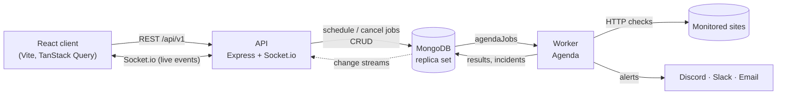

# PulseBoard

**Uptime monitoring and public status pages, built on the MERN stack.**
PulseBoard checks your websites and APIs every few seconds, opens an incident when one goes
down, alerts your team on Discord, Slack or email, shows everything live on a dashboard,
and publishes a public status page for your users.

MongoDB is the only infrastructure: it stores the data, it is the job queue (Agenda), and its
change streams are the realtime event bus. No Redis, no message broker.


## Features

- **HTTP checks every 10–30 s** (GET/HEAD/POST) with expected status range, keyword match,
  custom headers, timeout, up to 3 redirects, and a **DNS / TCP / TLS / TTFB / download**
  timing breakdown measured on a fresh connection every time. TLS certificate expiry badge.
- **Incidents without noise**: down after 3 consecutive failures, up after 2 successes.
  Race-safe (concurrent checks can't open two incidents) and timed from the first failed check.
- **Alerts** to Discord (embeds), Slack (Block Kit) and email (HTML), sent as background jobs
  with retries after 30 s, 2 min and 8 min, and a full incident timeline.
- **Live dashboard**: MongoDB change streams → Socket.io push status, response times and
  incidents to the browser instantly (falls back to polling if the socket drops).
- **Analytics**: uptime for 24 h / 7 / 30 / 90 days, response-time chart (1 h / 24 h / 7 d,
  downsampled server-side), timing breakdown, 90-day uptime bars. Every chart has a table view.
- **Public status pages**: no login, overall banner, per-service 90-day bars, incident
  history; whitelist-only data, cached for 30 s.
- **Teams**: workspaces with owner / member / viewer roles, enforced on every request.
- **"Test now"**: run a one-off check from the monitor form before saving.
- **Security**: JWT access tokens in memory + rotating httpOnly refresh cookie with reuse
  detection, bcrypt, SSRF protection (at save time _and_ connect time), helmet, strict CORS,
  rate limits, input validation with Zod everywhere.
- Dark-first UI with light mode, responsive down to phone width.

| Monitor detail                                  | Public status page                                      |
| ----------------------------------------------- | ------------------------------------------------------- |
|  |  |

| Landing page                                  | Incident timeline                            |
| --------------------------------------------- | -------------------------------------------- |
|  |  |

## Architecture



- **API** (`apps/api`): REST, auth, RBAC, analytics, Socket.io. Creates Agenda jobs but never
  runs them.
- **Worker** (`apps/worker`): runs `run-check`, `send-alert`, `rollup`, `finalize-rollup`
  jobs; serves only `/health`. Several workers can run at once; Agenda's locking means a check
  never runs twice.
- **Shared** (`packages/shared`): Mongoose models, Zod schemas (also used by client forms),
  check runner, SSRF guard, incident state machine, uptime maths.
- **Demo target** (`apps/demo-target`): a tiny site you can switch to up / down / slow / 500 /
  missing-keyword for live demos.

More diagrams (check lifecycle, incident states, data model) in
[docs/ARCHITECTURE.md](docs/ARCHITECTURE.md). Every design decision and its alternatives are
logged in [docs/DECISIONS.md](docs/DECISIONS.md). The full API is in [docs/API.md](docs/API.md).

## Tech stack

React 18, Vite, React Router, Tailwind CSS v4, TanStack Query, Recharts, Socket.io client,
React Hook Form + Zod · Node 20+, Express 5, Mongoose 9, Zod, JWT, bcrypt, helmet, pino,
Socket.io · MongoDB (time-series collection for checks, change streams) · Agenda v6 (MongoDB
backend) · Nodemailer · Vitest, Supertest, mongodb-memory-server.

## Run it locally

Requirements: **Node 20+**, **Docker Desktop** (for MongoDB).

```bash
git clone <repo-url> pulseboard && cd pulseboard
cp .env.example .env         # works as-is for local development
docker compose up -d         # MongoDB as a single-node replica set (rs0), needed for change streams
npm install
npm run seed                 # demo account + realistic history (safe to re-run)
npm run dev                  # api :4000 · worker :4002/health · client :5173 · demo-target :4011
```

Open <http://localhost:5173> and log in with **demo@pulseboard.dev / demo1234** (the login
page has a "Fill in" button in demo mode). The public status page is at
<http://localhost:5173/status/acme>, and the demo target's control panel at
<http://localhost:4011/admin>.

To receive real Discord or Slack alerts, put a webhook URL in `SEED_DISCORD_WEBHOOK_URL` or
`SEED_SLACK_WEBHOOK_URL` before seeding, or add a channel on the **Alert channels** page.
Without SMTP settings, email alerts go to a free Ethereal test inbox, and each message's preview
link appears in the incident timeline.

### Scripts

| Command                                       | What it does                                               |
| --------------------------------------------- | ---------------------------------------------------------- |
| `npm run dev`                                 | Runs API, worker, client and demo-target with live reload  |
| `npm run seed`                                | (Re)creates the demo account and its history               |
| `npm test`                                    | All test suites (shared, API, worker, client, demo-target) |
| `npm run test:coverage -w @pulseboard/shared` | Coverage of the shared core logic                          |
| `npm run lint`                                | ESLint across the monorepo                                 |
| `npm run format`                              | Prettier across the monorepo                               |

## Environment variables

All variables live in one `.env` at the repository root (see `.env.example`).

| Variable                   | Used by     | Default / example                                                           | Purpose                                                        |
| -------------------------- | ----------- | --------------------------------------------------------------------------- | -------------------------------------------------------------- |
| `NODE_ENV`                 | all         | `development`                                                               | `production` enables secure cookies and JSON logs              |
| `MONGODB_URI`              | api, worker | `mongodb://localhost:27017/pulseboard?replicaSet=rs0&directConnection=true` | Must be a replica set (change streams)                         |
| `LOG_LEVEL`                | api, worker | `info`                                                                      | pino log level                                                 |
| `DEMO_MODE`                | api, worker | `true`                                                                      | Allows 10 s check intervals (30 s otherwise); shows demo login |
| `ALLOW_PRIVATE_TARGETS`    | api, worker | `true` locally, `false` in production                                       | Allows monitoring localhost/private IPs (local demo-target)    |
| `API_PORT` (or `PORT`)     | api         | `4000`                                                                      | HTTP port                                                      |
| `CLIENT_ORIGIN`            | api         | `http://localhost:5173`                                                     | CORS + Socket.io allowed origin                                |
| `JWT_ACCESS_SECRET`        | api         | 32+ random chars                                                            | Signs access tokens                                            |
| `JWT_REFRESH_SECRET`       | api         | 32+ random chars, different                                                 | Signs refresh tokens                                           |
| `ACCESS_TOKEN_TTL`         | api         | `15m`                                                                       | Access token lifetime                                          |
| `REFRESH_TOKEN_TTL_DAYS`   | api         | `7`                                                                         | Refresh token lifetime                                         |
| `BCRYPT_COST`              | api         | `12`                                                                        | Password hashing work factor                                   |
| `AUTH_RATE_LIMIT_MAX`      | api         | `20`                                                                        | Login/register attempts per IP per 15 min                      |
| `TRUST_PROXY`              | api         | `false` (`true` on Render)                                                  | Real client IPs behind a proxy                                 |
| `WORKER_HEALTH_PORT`       | worker      | `4002`                                                                      | Worker `/health` port                                          |
| `AGENDA_MAX_CONCURRENCY`   | worker      | `20`                                                                        | Checks a worker runs in parallel                               |
| `DASHBOARD_URL`            | api, worker | `http://localhost:5173`                                                     | Links in alerts                                                |
| `SMTP_HOST` … `SMTP_PASS`  | api, worker | empty                                                                       | Email delivery; empty = Ethereal test inbox                    |
| `ALERT_FROM_EMAIL`         | api, worker | `PulseBoard <alerts@pulseboard.local>`                                      | Sender of alert emails                                         |
| `SEED_DISCORD_WEBHOOK_URL` | seed        | empty                                                                       | Creates a Discord channel when seeding                         |
| `SEED_SLACK_WEBHOOK_URL`   | seed        | empty                                                                       | Creates a Slack channel when seeding                           |
| `SEED_ALERT_EMAIL`         | seed        | empty                                                                       | Email channel target (default: the demo user)                  |
| `SEED_DEMO_TARGET_URL`     | seed        | empty → `http://localhost:4011/`                                            | Demo-target URL to monitor (set to the deployed one in prod)   |
| `DEMO_TARGET_PORT`         | demo-target | `4011`                                                                      | Port (4001 is often taken by VS Code)                          |
| `VITE_API_URL`             | client      | `/api/v1`                                                                   | API base path (proxied/rewritten to the API)                   |
| `VITE_SOCKET_URL`          | client      | `http://localhost:4000`                                                     | Socket.io server (the API's public URL in production)          |

## Testing

```bash
npm test
```

281 tests across five workspaces, all run against an in-memory MongoDB **replica set**
(so change streams and transactions behave like production):

- **Unit**: incident state machine (incl. flapping), uptime maths, SSRF IP checker, check
  evaluation, schemas, alert formatting.
- **Integration**: auth flow incl. refresh rotation and reuse detection; RBAC matrix; monitor
  CRUD + real Agenda jobs created/cancelled; check runner against a local HTTP server
  (timeouts, redirects, body cap); incident engine incl. a concurrency race; alert retries;
  rollups; analytics endpoints; status pages (public endpoint leaks nothing private).
- **Change streams**: monitor updates emit `check:result`, incident inserts emit
  `incident:opened`, and events missed during a restart are delivered via resume tokens.
- Shared core logic coverage: **≥ 90 % statements** (`npm run test:coverage -w @pulseboard/shared`).

## Deploy

**MongoDB Atlas**: create a cluster (the free M0 tier works; Atlas clusters are replica sets,
so change streams work), a database user, and allow access from Render. Copy the `mongodb+srv://`
connection string.

**Render (API, worker, demo-target)**: New → Blueprint → select this repository. Render reads
[`render.yaml`](render.yaml) and creates three services. Then fill in the variables marked
`sync: false`:

- `MONGODB_URI` (both API and worker): the Atlas string.
- `CLIENT_ORIGIN` and `DASHBOARD_URL`: your Vercel URL, e.g. `https://pulseboard.vercel.app`.
- SMTP settings (optional; without them, emails go to Ethereal).

JWT secrets are generated by Render. Background workers have no free plan on Render
(`starter`); the demo-target runs on the free plan.

**Vercel (client)**: import the repository, set **Root Directory** to `apps/client`
(framework: Vite). In [`apps/client/vercel.json`](apps/client/vercel.json) replace
`pulseboard-api.onrender.com` with your API's Render hostname; Vercel then proxies `/api/*` to
Render, so the refresh cookie stays first-party. Set the environment variable
`VITE_SOCKET_URL=https://<your-api>.onrender.com` (Socket.io connects to the API directly).

**Seed production** (optional): run once from your machine with production values:

```bash
MONGODB_URI="<atlas uri>" SEED_DEMO_TARGET_URL="https://<demo-target>.onrender.com/" \
SEED_DISCORD_WEBHOOK_URL="<webhook>" npm run seed
```

The worker reconciles jobs on start, so seeded monitors begin checking immediately.

## Demo script (about 5 minutes)

1. **Landing → login.** Open the site, show the pitch, log in as the demo user ("Fill in").
2. **Dashboard.** Four monitors with live sparklines; point at the **Live** indicator. Explain:
   the worker writes to MongoDB, change streams push to the browser.
3. **Monitor detail** (Checkout API). Uptime tiles, response-time chart (switch 1h/24h/7d),
   timing breakdown, 90-day bars (hover a day), the Table view toggle. Press **Test now**.
4. **Break it.** Open the demo-target control page (`/admin`) and click **down**.
   Back on the dashboard: within ~30 s (3 failed checks at 10 s) the card turns **red**, a
   "… is down" toast appears, and the Discord/Slack/email alert arrives.
5. **Incidents page.** Expand the open incident's timeline (opened → alert sent).
6. **Public status page.** Open `/status/acme` in a private window: banner shows the outage,
   no login needed.
7. **Fix it.** Click **up** on the demo target. After 2 successful checks (~20 s) the incident
   resolves with the correct duration, and a recovery alert is sent.
8. **(Optional) under the hood.** `/health` on API and worker; run two workers to show checks
   aren't duplicated (Agenda locking); `docs/DECISIONS.md` for the reasoning.

Tip: in production the free demo-target sleeps when idle; open its `/admin` page a minute
before the demo.

## Project structure

```
apps/
  api/           Express REST API, Socket.io, change streams, seed script
  worker/        Agenda jobs: checks, incident engine, alerts, rollups
  client/        React app (Vite)
  demo-target/   Switchable demo website
packages/
  shared/        Models, schemas, check runner, SSRF guard, state machine, uptime maths
docs/            ARCHITECTURE.md, API.md, DECISIONS.md, PROGRESS.md, screenshots/
docker-compose.yml  render.yaml  .env.example
```
