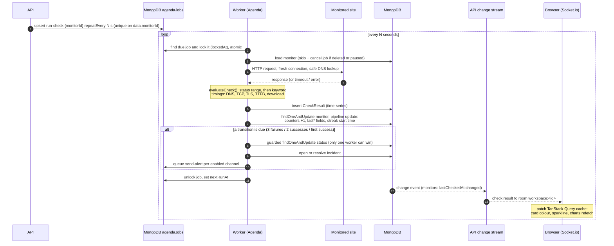
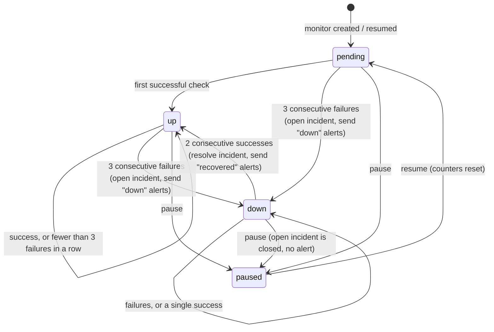
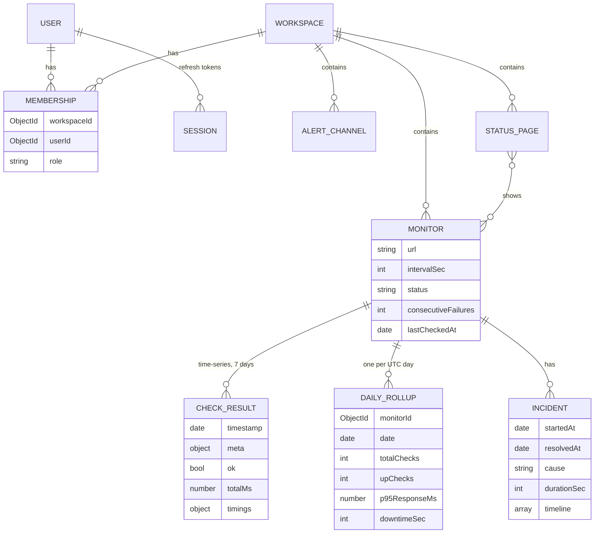

# Architecture

PulseBoard is four Node processes and one database. **MongoDB is the only shared
dependency**: it stores the data, it is the job queue (Agenda), and it is the event
bus (change streams). There is no Redis, RabbitMQ or other broker.

| Process            | Role                                                                                            | Serves HTTP?       |
| ------------------ | ----------------------------------------------------------------------------------------------- | ------------------ |
| `apps/client`      | React SPA (Vite). Dashboard, charts, public status pages.                                       | static files       |
| `apps/api`         | Express REST API + Socket.io. Auth, RBAC, CRUD, analytics. **Schedules** jobs, never runs them. | yes                |
| `apps/worker`      | Agenda job processor: runs checks, incident engine, alerts, rollups.                            | only `GET /health` |
| `apps/demo-target` | Tiny site whose behaviour can be switched (up/down/slow/500/keyword) for live demos.            | yes                |
| `packages/shared`  | Models, Zod schemas, check runner, SSRF guard, state machine, uptime maths. Used by all.        | n/a                |

## System overview

```mermaid
flowchart LR
    subgraph Browser
        C[React client<br/>TanStack Query cache]
        P[Public status page]
    end

    subgraph API["API process (Express + Socket.io)"]
        R[REST /api/v1]
        S[Socket.io<br/>rooms per workspace]
        CS[Change-stream watchers<br/>monitors, incidents]
        AG1[Agenda instance<br/>schedule only]
    end

    subgraph DB[(MongoDB replica set)]
        M[(monitors)]
        I[(incidents)]
        J[(agendaJobs)]
        CR[(checkresults<br/>time-series, 7d TTL)]
        DR[(dailyrollups)]
        O[(users, workspaces,<br/>memberships, sessions,<br/>alertchannels, statuspages)]
    end

    subgraph Worker["Worker process"]
        AG2[Agenda<br/>processEvery 5s]
        RC[run-check]
        IE[Incident engine]
        SA[send-alert]
        RU[rollup / finalize-rollup]
    end

    T[(Monitored sites<br/>incl. demo-target)]
    N[Discord / Slack / Email]

    C -- REST + access token --> R
    P -- GET /public/status/:slug<br/>cached 30s --> R
    C <-- websocket --> S
    R --> O & M & I
    R -- create / cancel jobs --> AG1 --> J
    J --> AG2
    AG2 --> RC & SA & RU
    RC -- HTTP check --> T
    RC -- raw result --> CR
    RC --> IE
    IE -- atomic counters, status --> M
    IE -- open / resolve --> I
    IE -- queue alerts --> J
    SA --> N
    SA -- timeline --> I
    RU -- $merge --> DR
    M -. change stream .-> CS
    I -. change stream .-> CS
    CS -- emit to workspace room --> S
```

The worker never calls the API and the API never runs checks; they only share the
database. Either side can be restarted, scaled or crash without taking the other down.

## Check lifecycle (one `run-check` job)



## Incident state machine



- Implemented as pure functions in `packages/shared/src/incident/stateMachine.js`
  (`nextMonitorState`, `decideTransition`) with 13 unit tests, including flapping.
- The worker applies it with **guarded updates** (`TRANSITION_GUARDS`), so concurrent
  checks can't open two incidents; a partial unique index (one open incident per
  monitor) is the final safety net. See D39–D41 in [DECISIONS.md](DECISIONS.md).
- `startedAt` = first failed check of the streak, `resolvedAt` = first good check, so
  `durationSec` is the real outage length.

## Alert delivery


## Realtime: change streams → Socket.io

- The API watches `monitors` (updates touching `lastCheckedAt` or `status`) and
  `incidents` (insert / update) with `$match` pipelines and `fullDocument: 'updateLookup'`.
- Time-series collections can't be watched, which is why the worker copies each result
  onto the Monitor document.
- Resume tokens are saved in `streamCheckpoints`; after a restart the stream continues
  where it stopped. Errors trigger a reconnect with exponential backoff.
- Sockets authenticate with the access token and only join `workspace:<id>` rooms for
  their memberships; events are only emitted to those rooms.
- The client patches its query cache from events; while connected it doesn't poll at
  all, and falls back to 30 s polling if the socket drops.

## Data model



Indexes and the reasoning behind each are listed in [DECISIONS.md](DECISIONS.md) (D10).

## Where the numbers come from

| Figure                     | Source                                                          |
| -------------------------- | --------------------------------------------------------------- |
| Live status, last response | `Monitor.last*` (updated by every check, pushed via sockets)    |
| 24 h uptime                | raw `checkresults`                                              |
| 7 / 30 / 90 day uptime     | `dailyrollups`, weighted by number of checks                    |
| Response-time chart        | raw checks, downsampled into ≤ 500 buckets for long ranges      |
| 90-day bars, status page   | `dailyrollups` (refreshed every 15 min, finalised at 00:05 UTC) |
| Downtime per day           | overlap of incidents with that day                              |

## Security summary

- Access token (15 min) in memory; refresh token (7 days) in an httpOnly, path-scoped
  cookie, rotated on every use with reuse detection. Only token hashes are stored.
- RBAC (`viewer < member < owner`) on every workspace route; non-members get 404.
- SSRF: monitor URLs are checked when saved **and** at connect time (custom DNS lookup),
  including every redirect hop; webhook URLs must be real Discord/Slack hosts.
- helmet, strict CORS, rate limits (auth, "test now", test alerts, public pages), body size
  limit, Mongo operator stripping, Zod validation on every input.
- Public status pages expose a whitelist of fields only (no URLs, ids or error details).
