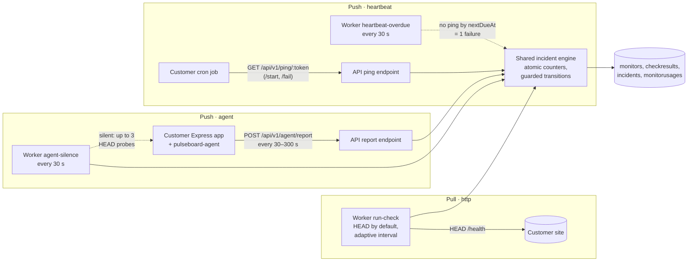
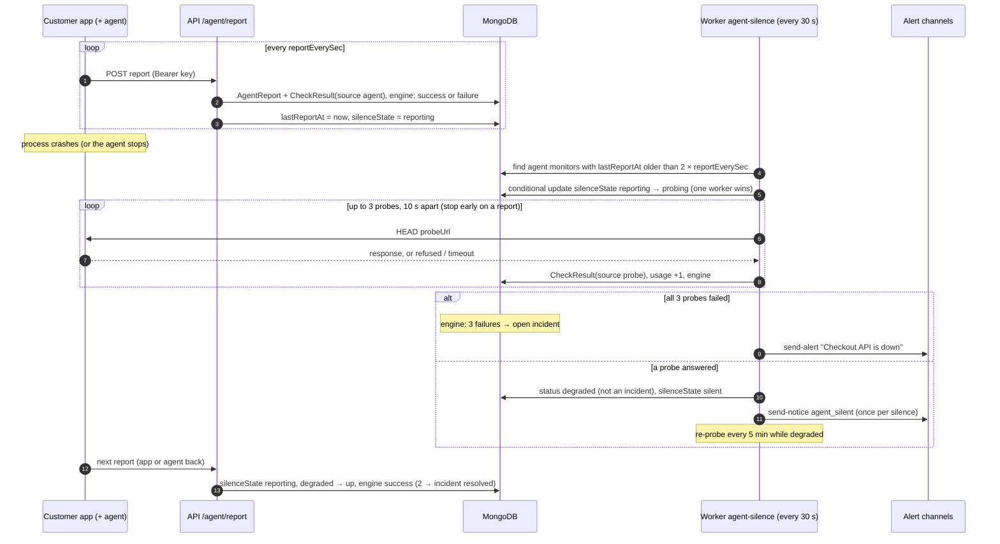
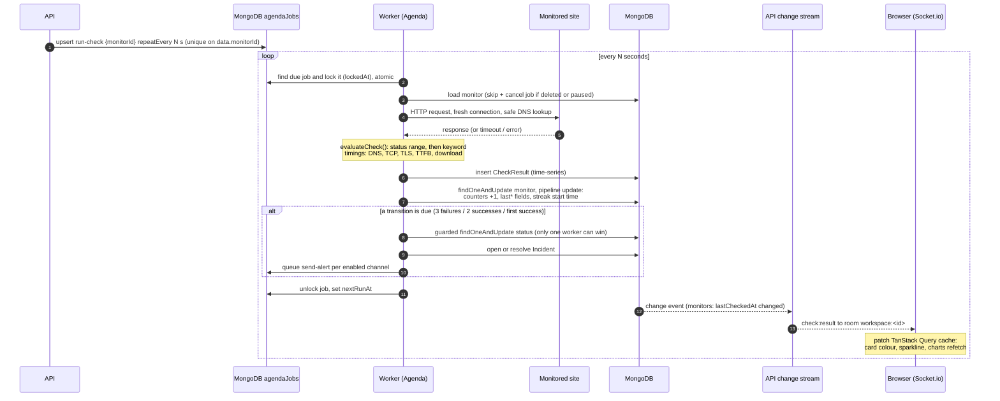
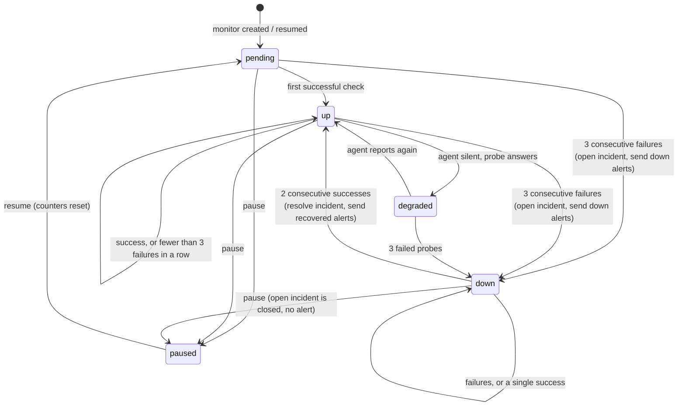
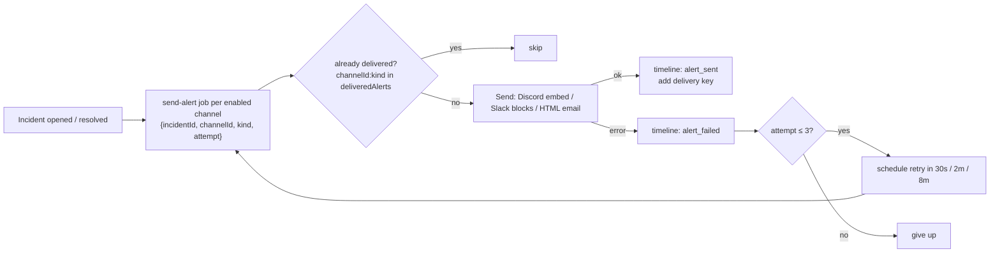
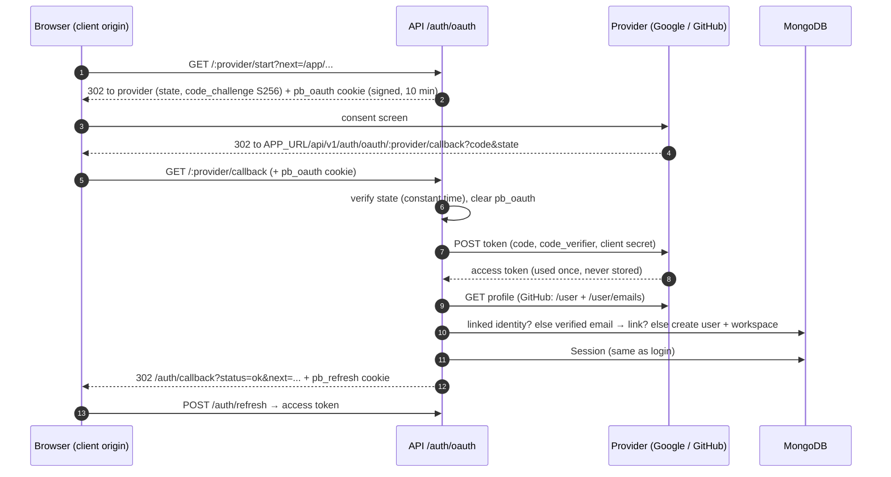
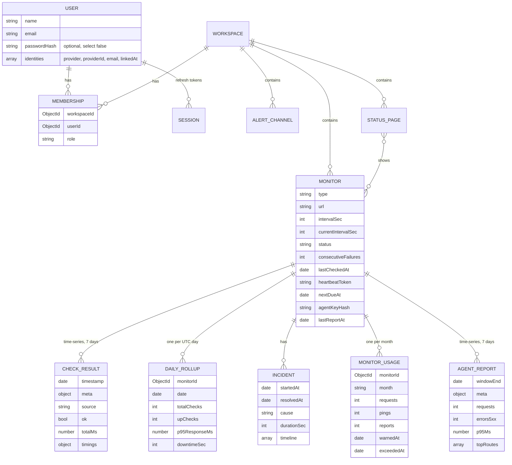

# Architecture

PulseBoard is four Node processes and one database. **MongoDB is the only shared
dependency**: it stores the data, it is the job queue (Agenda), and it is the event
bus (change streams). There is no Redis, RabbitMQ or other broker.

| Process            | Role                                                                                            | Serves HTTP?       |
| ------------------ | ----------------------------------------------------------------------------------------------- | ------------------ |
| `apps/client`      | React SPA (Vite). Dashboard, charts, public status pages.                                       | static files       |
| `apps/api`         | Express REST API + Socket.io. Auth, RBAC, CRUD, analytics. **Schedules** jobs, never runs them. | yes                |
| `apps/worker`      | Agenda job processor: runs checks, incident engine, alerts, rollups.                            | only `GET /health` |
| `apps/demo-target` | Tiny site whose behaviour can be switched (up/down/slow/500/keyword) for live demos.            | yes                |
| `packages/shared`  | Models, Zod schemas, check runner, SSRF guard, state machine, uptime maths. Used by all.        | n/a                |
| `packages/agent`   | `pulseboard-agent`, the npm package customers add to their Express app (zero dependencies).     | no (sends reports) |

Worker jobs: `run-check` (one per http monitor, or per agent monitor with external checks),
`send-alert`, `send-notice` (budget and agent-silent notices), `heartbeat-overdue` and
`agent-silence` (every 30 s), `rollup` (every 15 min), `finalize-rollup` (00:05 UTC) and
`budget-reset` (00:00 UTC on the 1st, and once at boot).

## System overview

```mermaid
flowchart LR
    subgraph Browser
        C[React client<br/>TanStack Query cache]
        P[Public status page]
    end

    subgraph API["API process (Express + Socket.io)"]
        R[REST /api/v1]
        S[Socket.io<br/>rooms per workspace]
        CS[Change-stream watchers<br/>monitors, incidents]
        AG1[Agenda instance<br/>schedule only]
    end

    subgraph DB["MongoDB replica set"]
        M[(monitors)]
        I[(incidents)]
        J[(agendaJobs)]
        CR[(checkresults<br/>time-series, 7d TTL)]
        DR[(dailyrollups)]
        O[(users, workspaces,<br/>memberships, sessions,<br/>alertchannels, statuspages)]
    end

    subgraph Worker["Worker process"]
        AG2[Agenda<br/>processEvery 5s]
        RC[run-check]
        IE[Incident engine]
        SA[send-alert]
        RU[rollup / finalize-rollup]
    end

    T[(Monitored sites<br/>incl. demo-target)]
    N[Email (Resend) / Discord / Slack]

    C -- REST + access token --> R
    P -- GET /public/status/:slug<br/>cached 30s --> R
    C <-- websocket --> S
    R --> O & M & I
    R -- create / cancel jobs --> AG1 --> J
    J --> AG2
    AG2 --> RC & SA & RU
    RC -- HTTP check --> T
    RC -- raw result --> CR
    RC --> IE
    IE -- atomic counters, status --> M
    IE -- open / resolve --> I
    IE -- queue alerts --> J
    SA --> N
    SA -- timeline --> I
    RU -- $merge --> DR
    M -. change stream .-> CS
    I -. change stream .-> CS
    CS -- emit to workspace room --> S
```

The worker never calls the API and the API never runs checks; they only share the
database. Either side can be restarted, scaled or crash without taking the other down.

**Combined mode.** With `RUN_MODE=combined` the API process also starts the worker (the same
`startWorker()` the standalone worker calls), so one web service does both jobs. The two still
only share the database, through two separate Agenda instances: the API's unstarted one writes
jobs, the worker's started one runs them. The trade-off is that a crash takes both down. See D96.

## Push vs pull: three monitor types

Polling costs the customer money: every check is a request their server (and often their
database or a paid API) has to answer. PulseBoard therefore prefers **push**: the customer's
systems tell us they're alive, and we only send requests when they go quiet.



Every type ends in the same place: a `CheckResult` (with `source`: `http`, `heartbeat`, `agent`,
`probe` or `external`) fed to the **same incident engine** (`@pulseboard/shared/incident`, used
by both the worker and the API). Uptime %, daily rollups, 90-day bars, status pages and alerts
work identically for all three. Only the thresholds differ:

| Type        | Opens an incident after | Resolves after | Why                                                              |
| ----------- | ----------------------- | -------------- | ---------------------------------------------------------------- |
| `http`      | 3 failed checks         | 2 good checks  | One failed request can be a network blip                         |
| `agent`     | 3 failed reports/probes | 2 good reports | Same, for reports over the error-rate / p95 threshold            |
| `heartbeat` | 1 missed period         | 1 ping         | The grace period already confirms; a daily job can't wait 3 days |

Requests each type sends to the customer (the figures on the Cost & Usage page):

| Type      | Requests a month                                                  | vs 1-minute polling (43,200) |
| --------- | ----------------------------------------------------------------- | ---------------------------- |
| http      | 2,592,000 / current interval (an upper bound when adaptive)       | 43,200 − estimate            |
| heartbeat | 0 (pings are requests _received_, counted as `pings`)             | 43,200                       |
| agent     | 0 while reporting; 3 probes per silence; optional external checks | 43,200 − external checks     |

## Probe-on-silence (agent monitors)

A silent agent might mean the app is down, or only that the agent (or its network path to us)
broke. The worker asks the app before deciding:



Without a `probeUrl` the worker feeds one failure per detector cycle ("No report for 130 s"),
so the incident opens after 3 cycles. With `externalCheckEverySec`, a normal `run-check` job also
checks `probeUrl` occasionally; a failure there starts the same 3-probe confirmation.

## Cost controls (http monitors)

- **HEAD by default**, no body download unless a keyword is set, `GET` fallback remembered on
  405/501. Every request carries `User-Agent: PulseBoard/1.0 (+<APP_URL>/bot)` and
  `X-PulseBoard-Check: 1`, so the customer can exclude checks from analytics and billing.
- **Usage metering**: every request sent (including fallbacks, redirect hops, probes and "Test
  now") is `$inc`'d into `MonitorUsage {monitorId, month}`, next to `pings` and `reports`.
- **Adaptive interval** (`nextInterval()`, pure): after 10 good checks in a row the interval
  doubles, up to `maxIntervalSec`; a failure or `down` drops it to `minIntervalSec`; a response
  slower than twice the 24 h moving average (time-weighted EWMA stored on the monitor) pulls it
  back to the base interval. The worker applies the new interval to the **running** Agenda job
  (in-memory `nextRunAt` plus the stored `repeatInterval`, see D71 and D75).
- **Budgets**: at 80 % of `monthlyRequestBudget` a warning notice is sent once (atomic
  `warnedAt` marker); at 100 % the monitor is slowed to every 15 min or paused, and a notice
  sent once. `budget-reset` undoes it on the 1st of the month; raising the budget undoes it at
  once.

## Check lifecycle (one `run-check` job)



## Incident state machine



Thresholds shown are for http and agent monitors; heartbeat monitors use 1 / 1 (see above).

- Implemented as pure functions in `packages/shared/src/incident/stateMachine.js`
  (`nextMonitorState`, `decideTransition`) with 13 unit tests, including flapping.
- The worker applies it with **guarded updates** (`TRANSITION_GUARDS`), so concurrent
  checks can't open two incidents; a partial unique index (one open incident per
  monitor) is the final safety net. See D39–D41 in [DECISIONS.md](DECISIONS.md).
- `startedAt` = first failed check of the streak, `resolvedAt` = first good check, so
  `durationSec` is the real outage length.

## Alert delivery



## Realtime: change streams → Socket.io

- The API watches `monitors` (updates touching `lastCheckedAt` or `status`) and
  `incidents` (insert / update) with `$match` pipelines and `fullDocument: 'updateLookup'`.
- Time-series collections can't be watched, which is why the worker copies each result
  onto the Monitor document.
- Resume tokens are saved in `streamCheckpoints`; after a restart the stream continues
  where it stopped. Errors trigger a reconnect with exponential backoff.
- Sockets authenticate with the access token and only join `workspace:<id>` rooms for
  their memberships; events are only emitted to those rooms.
- The client patches its query cache from events; while connected it doesn't poll at
  all, and falls back to 30 s polling if the socket drops.

## Sign in with Google / GitHub

Authorization code flow with PKCE. The provider redirects to the **client origin**, which proxies
`/api` to the API (Vite in dev, Vercel rewrite in prod), so both cookies stay first-party. A
provider is enabled only when its client id and secret are set.



Any failure redirects to `/auth/callback?status=error&code=OAUTH_…` without creating a session.
An unverified provider email never links to or creates an account (D89).

## Data model



Indexes and the reasoning behind each are listed in [DECISIONS.md](DECISIONS.md) (D10).

## Where the numbers come from

| Figure                     | Source                                                          |
| -------------------------- | --------------------------------------------------------------- |
| Live status, last response | `Monitor.last*` (updated by every check, pushed via sockets)    |
| 24 h uptime                | raw `checkresults`                                              |
| 7 / 30 / 90 day uptime     | `dailyrollups`, weighted by number of checks                    |
| Response-time chart        | raw checks, downsampled into ≤ 500 buckets for long ranges      |
| 90-day bars, status page   | `dailyrollups` (refreshed every 15 min, finalised at 00:05 UTC) |
| Downtime per day           | overlap of incidents with that day                              |
| Requests / pings / reports | `monitorusages`, one document per monitor per month             |
| Cost                       | requests × `costPer1kRequests` / 1000, per currency             |
| Requests saved             | 43,200 − the monitor's monthly estimate (floored at 0)          |
| Agent charts               | `agentreports`, merged into ≤ 500 buckets                       |

## Security summary

- Access token (15 min) in memory; refresh token (7 days) in an httpOnly, path-scoped
  cookie, rotated on every use with reuse detection. Only token hashes are stored.
- OAuth sign-in: state + PKCE (S256) in a signed, 10-minute, path-scoped cookie; provider tokens
  are used once and never stored; accounts are linked by **verified** email only; `next` is
  restricted to same-origin relative paths; no token ever appears in a URL.
- RBAC (`viewer < member < owner`) on every workspace route; non-members get 404.
- SSRF: monitor URLs are checked when saved **and** at connect time (custom DNS lookup),
  including every redirect hop; webhook URLs must be real Discord/Slack hosts.
- helmet, strict CORS, rate limits (auth, "test now", test alerts, public pages), body size
  limit, Mongo operator stripping, Zod validation on every input.
- Public status pages expose a whitelist of fields only (no URLs, ids or error details).
- Push endpoints: heartbeat tokens are 24 random bytes (unique index, regenerable); agent keys
  are stored only as SHA-256 hashes and shown once. Both are rate-limited per token/key, not per
  IP. Probe URLs go through the same SSRF guard as monitor URLs.
- The agent sends route **patterns** only (`/api/orders/:id`), never full URLs, ids, query
  strings, headers or bodies.
